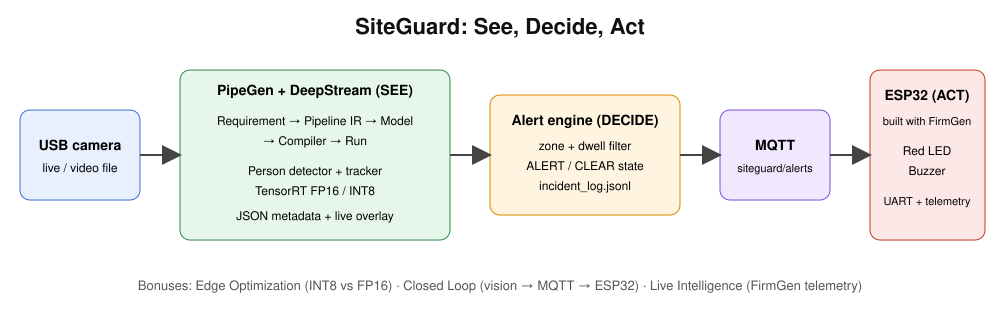

# SiteGuard: Physical AI Safety Sentinel
Sees (PipeGen + TensorRT + DeepStream), decides (zone + dwell alert engine), acts (ESP32 built with FirmGen).

## Architecture

USB camera -> PipeGen/DeepStream (detect + track, TensorRT FP16/INT8) -> JSON metadata
-> alerts/zone_dwell.py (zone + dwell, ALERT/CLEAR) -> MQTT `siteguard/alerts` -> ESP32 (LED + buzzer) + incident_log.jsonl

## Prerequisites
PipeGen 0.5.1 on x86-64 Linux + NVIDIA GPU (or Jetson JetPack 6), X11; Mosquitto; Python 3 + paho-mqtt; FirmGen 0.4.1 + ESP32 (for the loop).

## Run
1. `mosquitto -c alerts/mosquitto.conf`
2. `cd pipegen_export && ./run.sh`
3. `tail -F <pipegen_json_output> | python3 alerts/zone_dwell.py --stdin --mqtt`
4. `mosquitto_sub -t siteguard/alerts -v`

Test without a camera: `python3 alerts/zone_dwell.py --simulate`

## Configuration
alerts/config.json: zone polygon (normalized), dwell_seconds, clear_seconds, MQTT, input_adapter key mapping.

## Results
See evidence/fp16_vs_int8.md. [table]

## Bonuses claimed
Edge Optimization [yes/no] | Closed Loop [yes/no] | Live Intelligence [yes/no]

## Team
[names and roles]

## Scripts
- `scripts/run_demo.sh` starts broker + alert engine + MQTT log
- `scripts/latency_check.py` measures alert latency
- `scripts/collect_evidence.sh` snapshots environment info
- `scripts/fill_submission.py` builds docs/SUBMISSION_FINAL.md from evidence/results.json
